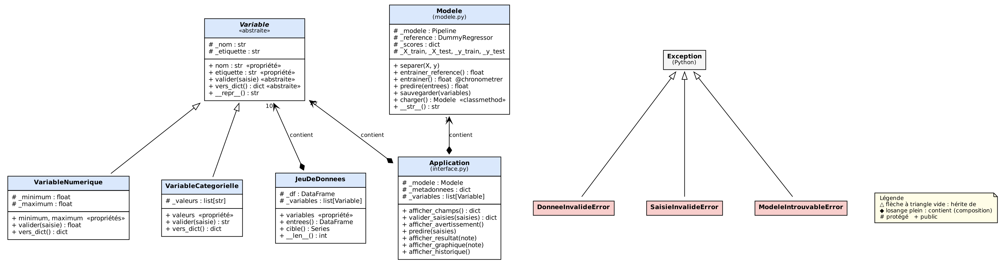
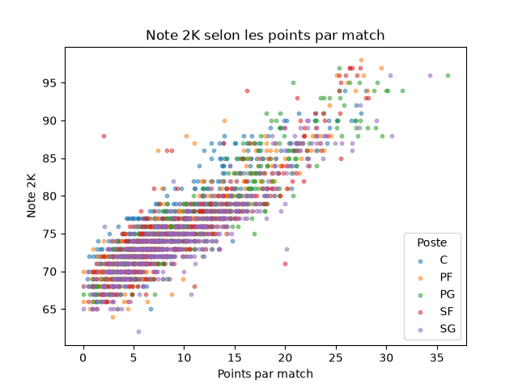

# Prédire la note NBA 2K d'un joueur à partir de ses vraies stats

Projet 2 INF1007 (A2026) — Kylian Amani (2445524) et Aziz Boly (2456875)

## Description
Cette application estime la note qu'un joueur NBA « mériterait » dans le jeu vidéo NBA 2K
à partir de ses vraies statistiques de la saison (poste, âge, matchs joués, minutes, points,
rebonds, passes, interceptions, contres et pourcentage de tirs réussis). L'utilisateur, par
exemple un fan de basketball qui veut comparer un joueur à sa note officielle, remplit les
champs, clique sur « Prédire » et obtient une note sur 99, un graphique et l'historique de ses
prédictions. Le modèle est une forêt aléatoire entraînée sur les saisons 2014-15 à 2019-20.
Il s'agit d'un exercice pédagogique : les notes produites ne sont pas des notes officielles de 2K.

## Jeu de données
- **Source** : CSV « stats NBA + note 2K » du dépôt GitHub
  [willyiamyu/nba2k_analysis](https://github.com/willyiamyu/nba2k_analysis)
  (statistiques de NBA.com, notes 2K des éditions 2K15 à 2K20).
- **Postes des joueurs** : colonne `POS` ajoutée à partir de
  [Basketball-Reference](https://www.basketball-reference.com/) (tableaux de stats par match,
  saisons 2014-15 à 2019-20), associée par nom de joueur et par saison. 11 lignes ont été
  complétées à la main (noms écrits différemment).
- **Licence** : aucune licence explicite n'est indiquée dans le dépôt source. Les données sont
  publiques et utilisées ici uniquement dans un cadre éducatif. Ce point a été signalé à
  l'auxiliaire lors de la validation du jeu de données.
- **Taille** : 2 412 lignes (un joueur pour une saison) et 32 colonnes ; 2 408 lignes et
  11 colonnes après nettoyage (10 entrées + la cible `rankings`).
- **Données personnelles** : la colonne `PLAYER` (nom du joueur) est retirée au nettoyage.

## Installation
```bash
git clone https://github.com/kylian-cloud/2026A-Projet2.git
cd 2026A-Projet2
pip install -r requirements.txt
```

## Lancement
Toutes les commandes se lancent **depuis la racine du projet** (le dossier `2026A-Projet2`).
L'option `-m` est nécessaire : elle permet à Python de trouver le paquet `src`.

1. Entraîner et sauvegarder le modèle (une seule fois, environ 2 secondes) :
   ```bash
   python -m src.main entrainer
   ```
2. Lancer l'interface (une page s'ouvre dans le navigateur, `Ctrl + C` pour l'arrêter) :
   ```bash
   python -m src.main
   ```
3. Lancer les tests :
   ```bash
   pytest
   ```
4. Mesurer la couverture des tests :
   ```bash
   coverage run -m pytest
   coverage report
   ```

## Structure du code
```
src/
├── donnees.py      (A) lecture, nettoyage, graphique d'exploration, classes Variable, JeuDeDonnees
├── exceptions.py   (A + B) exceptions personnalisées
├── modele.py       (B) entraînement, évaluation, sauvegarde, prédiction
├── historique.py   (B) historique des prédictions
├── interface.py    (A + B) interface graphique Streamlit
└── main.py         (B) point d'entrée
tests/
├── test_donnees.py (A)
└── test_modele.py  (B)
```

**Principales notions de POO utilisées :**
- **Héritage et polymorphisme** : `Variable` (classe abstraite) → `VariableNumerique` et
  `VariableCategorielle`. Chaque classe redéfinit `valider()` et `vers_dict()` ; l'interface
  appelle `variable.valider(...)` sans connaître le type de la variable.
- **Composition** : `JeuDeDonnees` contient une liste de `Variable` ; `Application` contient
  le `Modele` et la liste des `Variable`.
- **Encapsulation** : attributs protégés (`_nom`, `_minimum`…) lus par des propriétés en
  lecture seule (`@property`).
- **Méthodes spéciales** : `__repr__`, `__str__`, `__len__`.
- **Exceptions personnalisées** : `DonneeInvalideError`, `SaisieInvalideError`,
  `ModeleIntrouvableError`.



Le schéma est modifiable dans draw.io : `schema_classes.drawio`.

## Exploration des données


La note 2K augmente presque linéairement avec les points par match. Les couleurs (postes) sont
mélangées : à points égaux, le poste change peu la note. Les quelques points isolés en haut à
gauche sont des stars blessées qui ont très peu joué mais gardent une note élevée.

## Résultats du modèle
RMSE calculées sur le même ensemble de test (25 % des données, graine 42). La référence
prédit toujours la moyenne des notes d'entraînement ; la forêt aléatoire encode `POS`
dans un pipeline scikit-learn.

| Modèle | Métrique | Valeur |
|---|---|---|
| Référence (moyenne) | RMSE (test) | 5,7 |
| Forêt aléatoire | RMSE (test) | 2,1 |
| Forêt aléatoire | RMSE (entraînement) | 0,8 |

Le modèle se trompe en moyenne d'environ 2 points sur 99, soit environ 2,7 fois moins que la
référence. L'écart entre l'entraînement (0,8) et le test (2,1) montre un léger
sur-apprentissage, habituel pour une forêt aléatoire.

**Limites connues :**
- les joueurs blessés qui ont peu joué sont fortement sous-estimés (ex. 1 match et 2 points
  par match : note prédite d'environ 75 au lieu de 88), car la note 2K reflète aussi la
  réputation du joueur, pas seulement les stats de la saison ;
- les saisies sont limitées aux valeurs observées dans les données (ex. 0 à 36,1 points par
  match), car une forêt aléatoire ne sait pas extrapoler au-delà de ce qu'elle a vu ;
- les données s'arrêtent à la saison 2019-20.

## Couverture des tests
Mesurée avec `coverage run -m pytest` puis `coverage report` (34 tests, tous réussis) :

| Fichier | Lignes | Non couvertes | Couverture |
|---|---|---|---|
| `src/donnees.py` | 131 | 12 | 91 % |
| `src/exceptions.py` | 3 | 0 | 100 % |
| `src/historique.py` | 25 | 2 | 92 % |
| `src/modele.py` | 128 | 16 | 86 % |
| `tests/` (3 fichiers) et `conftest.py` | 155 | 0 | 100 % |
| **Total** | **432** | **30** | **93 %** |

Sur les seuls modules de logique (`donnees.py`, `exceptions.py`, `historique.py`, `modele.py`),
la couverture est d'environ **90 %** (257 lignes couvertes sur 287) : le total de 93 % inclut
aussi les fichiers de tests eux-mêmes.

L'interface Streamlit (`interface.py`) et le point d'entrée (`main.py`) ne sont pas testés
automatiquement : ils ont été vérifiés à la main en lançant l'application (cas normal, saisie
non numérique, champ vide, valeur hors limites).

## Outil du chapitre 7
Le décorateur `@chronometrer` (dans `modele.py`) mesure et affiche la durée de l'entraînement
du modèle.

## Documentation consultée
- pandas — `read_csv` : https://pandas.pydata.org/docs/reference/api/pandas.read_csv.html
- scikit-learn — `RandomForestRegressor` :
  https://scikit-learn.org/stable/modules/generated/sklearn.ensemble.RandomForestRegressor.html
- scikit-learn — `Pipeline` :
  https://scikit-learn.org/stable/modules/generated/sklearn.pipeline.Pipeline.html
- Streamlit — `st.cache_resource` :
  https://docs.streamlit.io/develop/api-reference/caching-and-state/st.cache_resource
- Matplotlib — `scatter` :
  https://matplotlib.org/stable/api/_as_gen/matplotlib.axes.Axes.scatter.html
